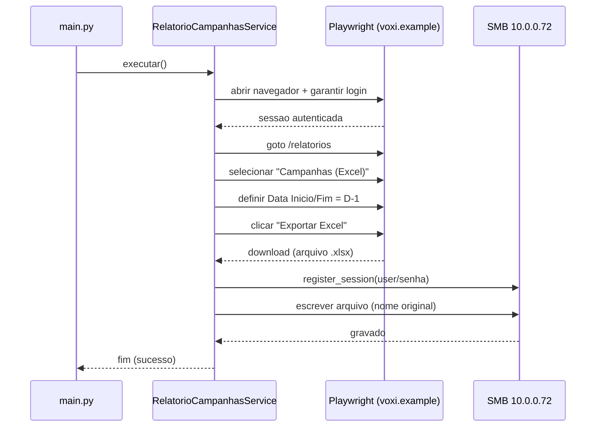

# 01 — Arquitetura (Fase 1)

> **Projeto:** RoboBulkChatBot · **Jira:** [KAN-485](https://empresa.atlassian.net/browse/KAN-485)
> **Tipo:** Script/Automação · **Data:** 2026-08-27

## 1. Problema

Todos os dias é preciso extrair do painel **voxi.example** o relatório **"Campanhas (Excel)"**
referente ao **dia anterior (D-1)** e disponibilizá-lo no compartilhamento de rede
`\\10.0.0.72\Automacao\RELATORIOS_CAMPANHAS_CHATBOT`. Hoje isso é feito manualmente:
login → tela de Relatórios → escolher o tipo de relatório → ajustar a data → exportar → mover
o arquivo para o SMB. O robô automatiza esse fluxo para rodar sem intervenção (agendado, headless).

## 2. Solução (visão geral)

Automação em **Python + Playwright** que:

1. Faz login em `https://voxi.example/login` (com reuso de sessão salva).
2. Abre `https://voxi.example/relatorios`.
3. Seleciona o tipo **"Campanhas (Excel)"** no combobox de "Tipo de Relatório".
4. Define **Data Início** e **Data Fim** como **D-1** (ontem).
5. Clica em **"Exportar Excel"** e captura o download.
6. Publica o arquivo baixado (nome original) no destino **SMB** via `smbclient`.

Segue o padrão de arquitetura em camadas já usado nos robôs do Grupo Acme
(`RoboAtualizaQualidadeTwilio`, `RoboCargas`, `AutomacaoOrganizacaoArquivos`):
`application/service` (orquestração) · `infrastructure` (Playwright/SMB/log) · `shared/utils` (config).

## 3. Componentes

| Componente | Responsabilidade |
|---|---|
| `main.py` | Ponto de entrada; configura log e dispara o serviço. |
| `RelatorioCampanhasService` | Orquestra o fluxo ponta a ponta (sessão → export → SMB). |
| `voxi_session` | Abre o navegador (headless configurável) e garante sessão logada. |
| `voxi_login` | Detecta a tela de login e preenche e-mail/senha. |
| `voxi_relatorio_scraper` | Seleciona o tipo de relatório, define as datas (D-1) e exporta o Excel. |
| `smb_destino` | Registra sessão SMB e grava o arquivo no compartilhamento de destino. |
| `env_load` | Carrega `.env` em dicionários de configuração (`VOXI_CONFIG`, `SMB_CONFIG`). |
| `log_config` | Logging rotativo em arquivo + console. |

> **Arquivos de diagrama:** fonte editável (`.mmd`) e imagem renderizada (`.png`)
> — Fluxo principal: [`.mmd`](diagramas/fluxo-principal.mmd) · [`.png`](diagramas/fluxo-principal.png)
> — Sequência ponta a ponta: [`.mmd`](diagramas/sequencia-ponta-a-ponta.mmd) · [`.png`](diagramas/sequencia-ponta-a-ponta.png)

### Imagens renderizadas

**Fluxo principal**


**Sequência ponta a ponta**


## 4. Fluxo principal

```mermaid
flowchart TD
    A[main.py] --> B[RelatorioCampanhasService.executar]
    B --> C[voxi_session: abrir navegador headless]
    C --> D{Sessao salva valida?}
    D -- Nao --> E[voxi_login: preencher email + senha]
    D -- Sim --> F[Ir para /relatorios]
    E --> F[Ir para /relatorios]
    F --> G[Scraper: selecionar 'Campanhas (Excel)']
    G --> H[Scraper: Data Inicio = Data Fim = D-1]
    H --> I[Scraper: clicar 'Exportar Excel' e capturar download]
    I --> J[smb_destino: register_session no 10.0.0.72]
    J --> K[Gravar arquivo .xlsx no destino SMB]
    K --> L[Log de sucesso / encerrar navegador]
```

## 5. Sequência (ponta a ponta)



## 6. Dados de entrada/saída

- **Entrada:** credenciais voxi.example (`.env`), data de referência D-1 (calculada em runtime).
- **Saída:** arquivo Excel de campanhas do dia anterior em
  `\\10.0.0.72\Automacao\RELATORIOS_CAMPANHAS_CHATBOT\<nome-original>.xlsx`.

## 7. Decisões da Fase 1

- **Playwright (sync)**: padrão já adotado nos robôs de scraping do grupo.
- **Reuso de sessão (`storage_state`)**: evita relogar a cada execução e reduz risco de bloqueio.
- **SMB via `smbclient.register_session`**: mesmo padrão do `RoboCargas`/`AutomacaoOrganizacaoArquivos`.
- **D-1 nas duas datas** (Início e Fim iguais): o relatório de campanhas é por dia de envio.

## 8. Critério de pronto (Fase 1) ✅

- [x] Diagrama de componentes e de fluxo de ponta a ponta.
- [x] Entradas/saídas definidas.
- [x] Alinhado ao padrão de arquitetura dos robôs existentes.
